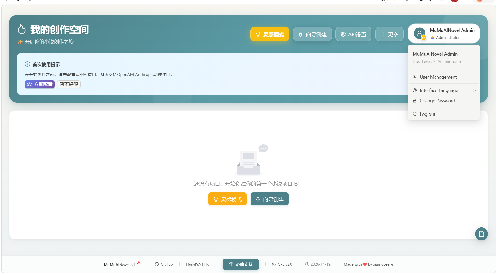
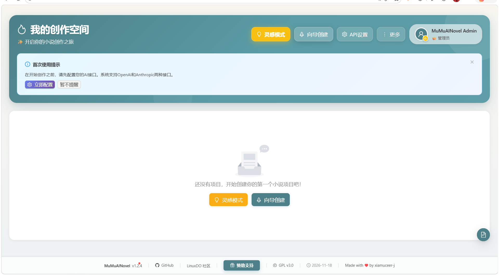
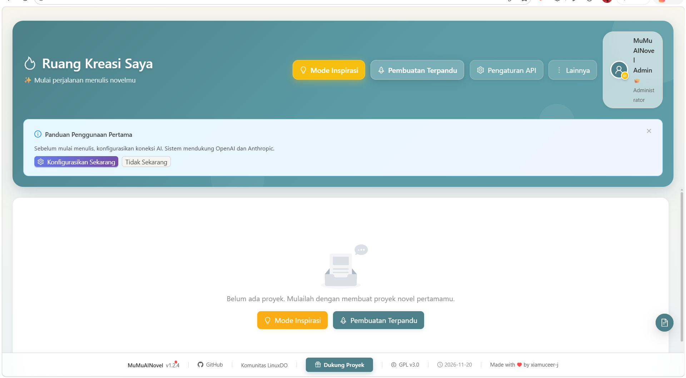
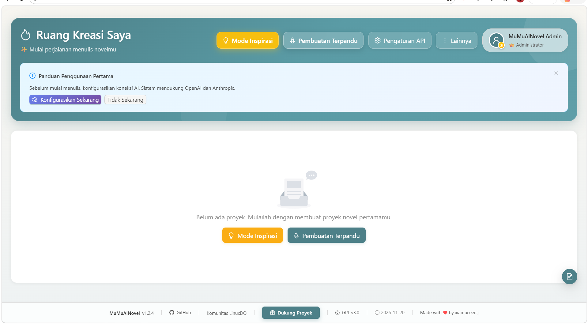
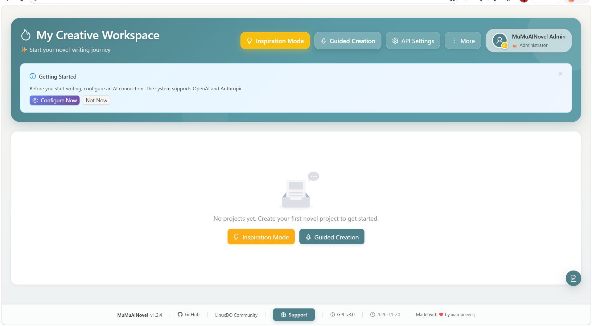
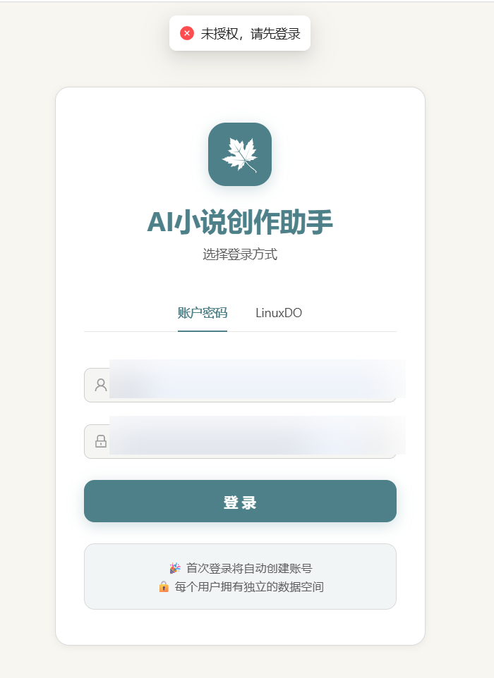
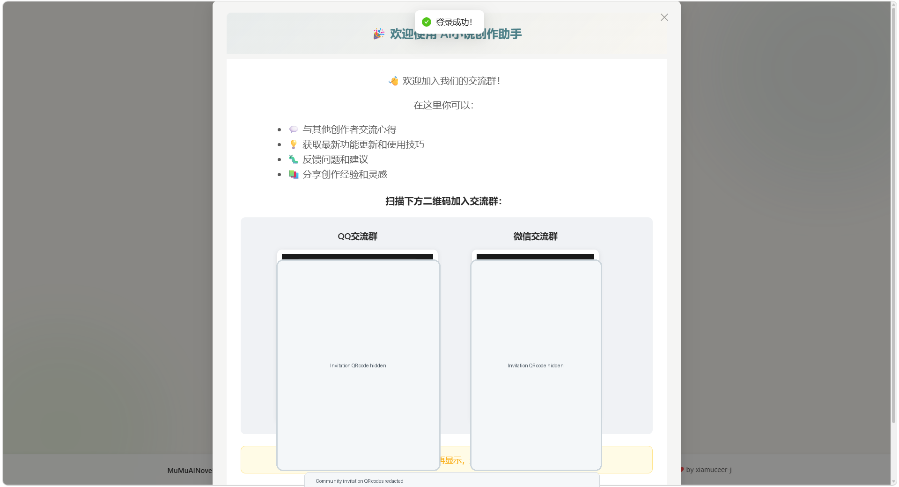

# Localization Screenshot Gallery

This gallery records visual checkpoints from the interface-localization work in the `kadal-stacks/MuMuAINovel` fork. Screenshots were captured from a self-hosted test instance on 19-20 November 2026.

> These images document UI behavior and translation coverage, not a release build or production deployment guarantee. The screenshots show an empty test workspace. They do not imply that project content or AI-generated novel text is translated by the interface-language setting.

## Account menu and language selection

### Indonesian account menu

*Captured 19 November 2026.* The account menu is displayed in Bahasa Indonesia. At this checkpoint, the workspace content itself had not yet received the broader translation sweep.

### English account menu

*Captured 19 November 2026.* The same account-menu controls are displayed in English. The interface preference is per account and independent of novel content and AI-generation prompts.

## Workspace localization

### Original Simplified Chinese workspace baseline

*Captured 19 November 2026.* This is the pre-sweep visual baseline for the workspace landing page.

### Indonesian workspace before the profile-card layout adjustment

*Captured 20 November 2026.* The workspace text is translated, but the longer account label is squeezed into a narrow profile card. This screenshot records the UI issue that was subsequently fixed.

### Indonesian workspace after the layout adjustment

*Captured 20 November 2026.* The profile card has enough horizontal space, and the workspace header, first-use notice, empty state, primary actions, and footer are displayed in Bahasa Indonesia.

### English workspace after the layout adjustment

*Captured 20 November 2026.* The same workspace areas are displayed in English, with the account name and role remaining legible.

## Remaining localization gaps observed at capture time

### Login screen

*Captured 20 November 2026.* The login screen and its authentication notice still contain Simplified Chinese text at this checkpoint. The test username and password values have been redacted in this documentation copy.

### First-login welcome announcement

*Captured 20 November 2026.* The first-login welcome/community announcement still contains Simplified Chinese text at this checkpoint. Community invitation cards, including their QR codes and group identifiers, have been obscured to avoid publishing invite links unintentionally.

## Scope and handling notes

- The 29 images shared during the setup and localization sessions were reviewed. This gallery keeps the eight screenshots that directly explain interface-localization progress and remaining gaps.
- Terminal, editor, file-manager, VM, and Portainer screenshots were not copied into this public gallery. They are troubleshooting evidence for one local environment and may expose host-specific paths, account names, runtime details, or other information that does not belong in general project documentation.
- Original uploaded screenshots are not modified. Only the sanitized copies in this gallery are intended for public repository use.
- When a pending screen is localized, replace or supplement its pending-state screenshot with a fresh visual verification screenshot and update `docs/I18N_PROGRESS.md`.
